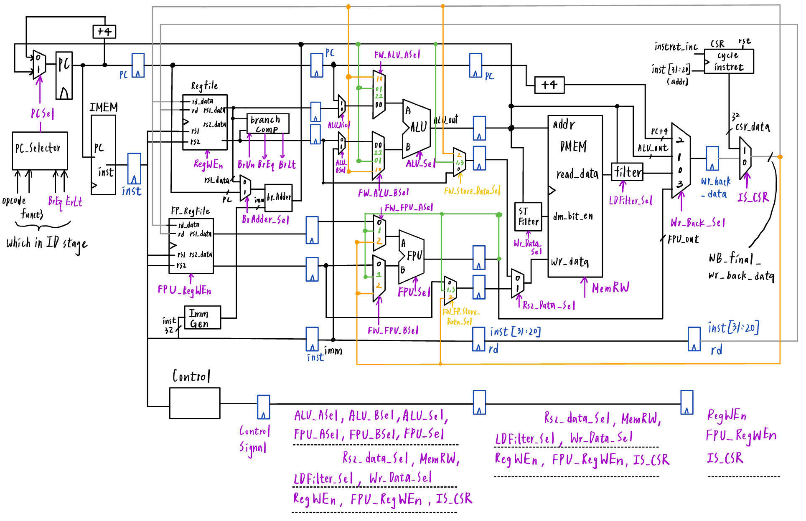

# RISC-V 5-stages Pipeline CPU
This is a 32-bit, five-stage pipelined RISC-V CPU that implements a subset of the RV32IMF ISA, selected instructions from the B (bit-manipulation) extension, and custom DSP instructions. It also supports selected Zicsr instructions and the `cycle` and `instret` counters.

## Datapath

- Blue lines represent pipeline registers
- Black lines represent wires and other hardware units
- Purple lines represent control signal
- Green and orange lines represent M and WB stage forwarding

### [Stall and flush logic](./Stall_Flush_Logic.md)

### [Forwarding logic](./Forwarding_Logic.md)

### [IMEM handshake logic](./IM_Handshake.md)

### [DMEM handshake logic](./DM_Handshake.md)